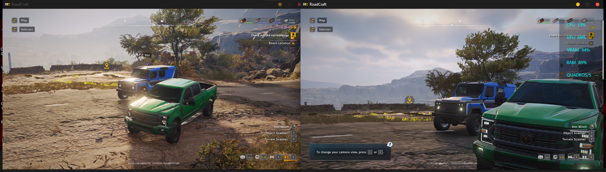

# RoadCraft LAN Emu



I built this project to play RoadCraft co-op over a local network and explore
which multiplayer services could be handled locally.

## RoadCraft LAN Emu

`roadcraft_lan_emu.dll` provides LAN discovery, session hosting and joining, and the RTC
signaling needed to connect the players.

**Verified in game:** one instance hosted a public session, the other found and
joined it, and both players entered the same map and saw each other's vehicles
move. This test used two Windows users with distinct Steam identities on one PC.

## Tested setup

The LAN emulator was tested on **RoadCraft for Steam, build 7.4.PATCH.763699 /
767189, with [Goldberg Steam Emulator (GBE Fork)](https://github.com/Detanup01/gbe_fork)**. This preview was tested with two instances
on one PC. Other game builds, separate PCs, and long co-op sessions remain
unverified.

## Installation

1. Download the Windows x64 ZIP from [v0.1.0-preview.1](https://github.com/Vlxst/Roadcraft-Lan-Emu/releases/tag/v0.1.0-preview.1).
2. Extract `roadcraft_lan_emu.dll` and place it in your x64 DLL loader's load
   directory. The loader must load it into `Roadcraft - Retail.exe`.
3. If you use [Ultimate ASI Loader (x64)](https://github.com/ThirteenAG/Ultimate-ASI-Loader),
   rename `roadcraft_lan_emu.dll` to `roadcraft_lan_emu.asi` and place it in
   the loader's plugin directory.

Use the same LAN build on both clients. Host a public session and use
**Find Game** on the guest with matching difficulty filters.

## Why development stopped

I stopped after getting two-player LAN co-op working because running both
instances on one PC was too demanding for my hardware. I’m sharing the source and compiled LAN DLL so anyone interested can continue from this preview.

## Build

Install Visual Studio 2022 Build Tools with Desktop development with C++ and a
Windows SDK. From an x64 Native Tools Command Prompt:

```bat
native\build.cmd
```

The build produces the LAN DLL in native/build.
The project code uses the MIT license. Third-party notices for nlohmann/json
and MinHook are in `native/`.
